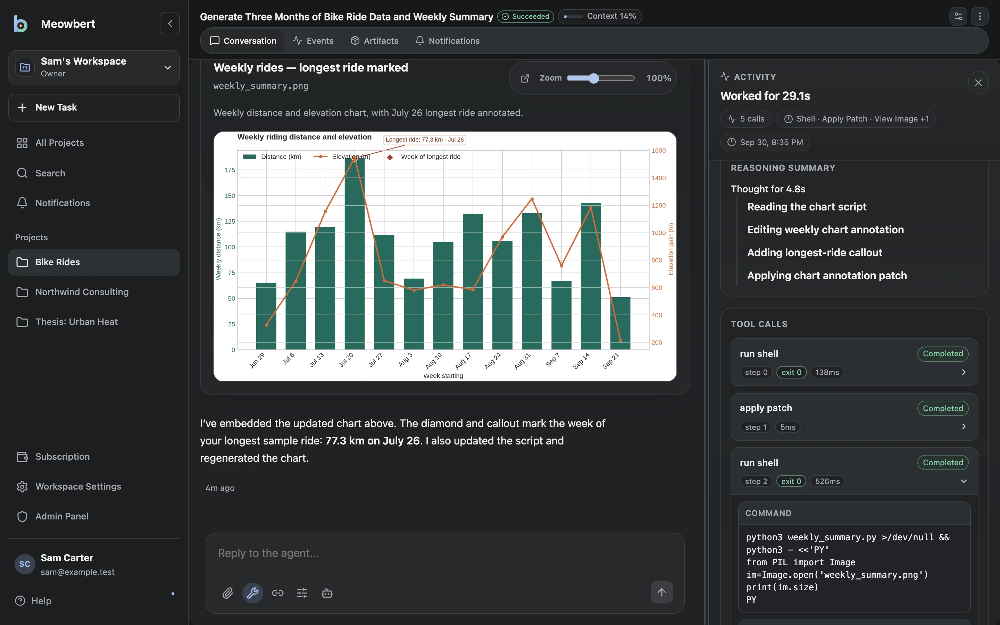
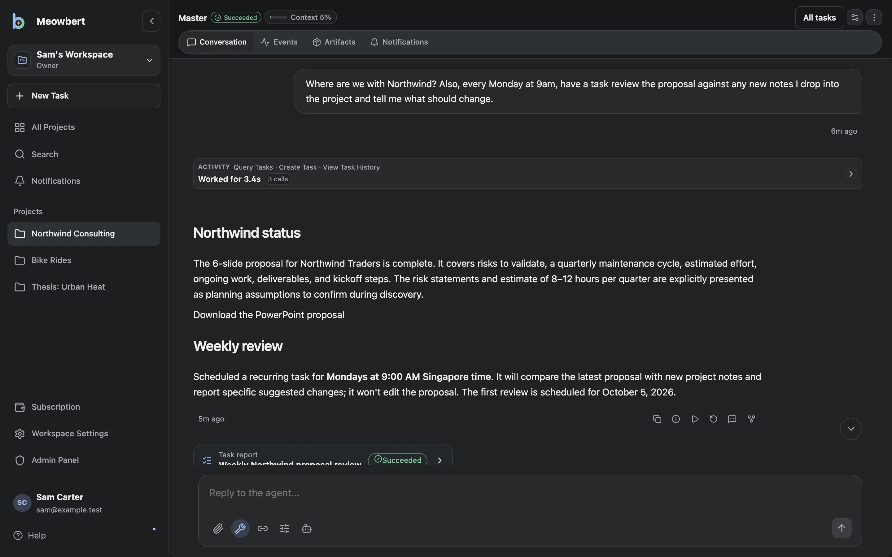

## Where to start

**Someone gave you an account.** You don't need to install anything. Sign in, then read [Projects and tasks](/getting-started/overview) to learn how work is organized, and run your first task below.

**You want your own server.** Follow the [Quickstart](/getting-started/quickstart). It takes about ten minutes on a Linux machine with Docker, plus the time to download the images.

## Your first task

1. **Open a project.** Every workspace starts with one. Projects keep files, instructions and every task you run in them.
2. **Tell the project's Master what you need.** For example: *"Find the five most-starred Rust web frameworks on GitHub and write a comparison table to `frameworks.md`."* The Master writes a brief and starts a task.
3. **Do something else.** The task runs in its own sandbox with a shell, a browser and Office tools. When it finishes, the Master tells you. Reply in the same conversation to ask for changes.

## Find a topic

| I want to… | Read |
| --- | --- |
| Start and steer tasks | [Task Composer](/core-workflows/task-composer), [Task Follow-up](/core-workflows/task-follow-up) |
| Run a task every morning, or for hours | [Scheduled & Infinite Tasks](/core-workflows/scheduled-tasks) |
| Have a reviewer check big jobs | [Workflows & Agent Swarm](/core-workflows/task-workflows) |
| Send tasks from Telegram, Discord, GitHub or email | [Connectors](/core-workflows/connectors) |
| Use the desktop app | [Desktop App](/getting-started/desktop-app) |
| Add models | [Models & Providers](/self-hosting/models-and-providers) |
| Lock down the sandbox | [Sandbox & Security](/self-hosting/sandbox-security) |
| Fix something | [Common Issues](/troubleshooting/common-issues) |
