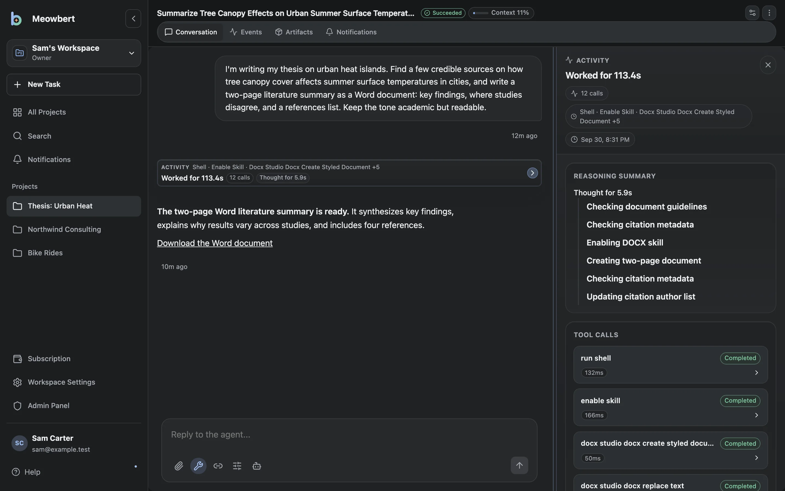

# What is Meowbert?

Meowbert is an AI agent server you run yourself. You describe a job, and an agent works on it with real tools: a shell, a browser, Python, and Office and PDF tools, inside its own sandbox. It keeps going when you close the app, and it tells you when it's done.

Most AI chat apps answer one message at a time, and you check each answer yourself. Meowbert is built for handing work off:

- **Each project has a Master.** You tell it what you need. It writes a brief, starts a task, checks on it, and reports back, in the app or in Telegram, Discord, GitHub or email.
- **Each task gets its own sandbox.** The agent can install packages and run the code it writes, but it can only reach that sandbox and the project's files.
- **Big jobs can be reviewed.** Long Horizon, Deep Research and Agent Swarm tasks go to a separate reviewer, which can send the work back. The task only finishes once the reviewer approves.
- **Work is kept.** Projects keep their files, memory and every task, so you can continue a task weeks later.

For example, you can ask it to turn a folder of 300 PDFs into a spreadsheet, fix a failing test in a repository, or check three websites every morning and tell you what changed.

## How it works

Three parts work together:

- **The app** is where you describe work, attach files, read results and steer a task. Use the browser or Meowbert Desktop.
- **Your Meowbert server** stores conversations and settings, coordinates tasks, and connects to your chosen models.
- **The task executor** runs commands and tools. It normally runs in a sandbox on the server; the desktop app can also execute tasks on your computer.

The model decides the next actions; Meowbert executes the tool calls and sends the results back until the task finishes or needs your input. A task is more than a chat response: it can create files, run scripts, test changes and report the result.

## Workspaces, Projects and tasks

A **workspace** groups access, connected services and shared settings. A **Project** holds related files, context and task history. A **task** is one conversation about an outcome inside a Project.

For example, a Personal workspace could have Reports and Website Projects, each with several task conversations. See [Projects and tasks](/getting-started/overview) for the full explanation.

## Where the work runs

Meowbert's server runs on hardware you control: for example, a home server, VPS or laptop. There is no required Meowbert-operated cloud service. In the task composer, **Cloud** means execution on your Meowbert server.

Server tasks normally execute in short-lived Docker sandboxes with resource limits. Optional gVisor adds stronger isolation. [Local tasks](/getting-started/desktop-app/local-tasks) execute on your computer through the desktop app, either in Docker or directly in Host mode. Host mode has the authority of your user account and requires permission.

Where commands run and where files live are separate decisions. A local task can use an existing server workspace only when it can access that workspace's storage. A workspace created **On this device** keeps its files on the owning computer.

## Models and data

You choose the model provider. Meowbert supports providers and gateways with the OpenAI Responses API, including compatible model servers you run yourself. Operators can offer multiple models and agent presets; users can bring their own provider when enabled.

The Meowbert server stores conversations and task settings. Workspace files live on their configured server storage or owning device. Content the agent reads is sent to the selected model provider, even when the task executes locally. Self-hosting Meowbert does not automatically make an external model provider local.

See [Models & Providers](/self-hosting/models-and-providers) for operator settings and [Bring Your Own Provider](/core-workflows/byo-providers) for user connections.

## Ways to use Meowbert

| You want to… | Start here |
| --- | --- |
| Use an existing server and run a first task | [Projects and tasks](/getting-started/overview) |
| Install your own server | [Quickstart](/getting-started/quickstart) |
| Work from your computer's desktop app | [Desktop App](/getting-started/desktop-app) |
| Run tasks on a schedule | [Scheduled & Infinite Tasks](/core-workflows/scheduled-tasks) |
| Plan and review larger work, or split it across agents | [Workflows & Agent Swarm](/core-workflows/task-workflows) |
| Send tasks from Telegram, Discord, GitHub or email | [Connectors](/core-workflows/connectors) |

Meowbert is open source under the [AGPL-3.0](https://github.com/XInTheDark/meowbert-ai-agent/blob/main/LICENSE). See [System Requirements](/introduction/requirements) and [Known Limitations](/introduction/limitations) before choosing a hosting setup.
